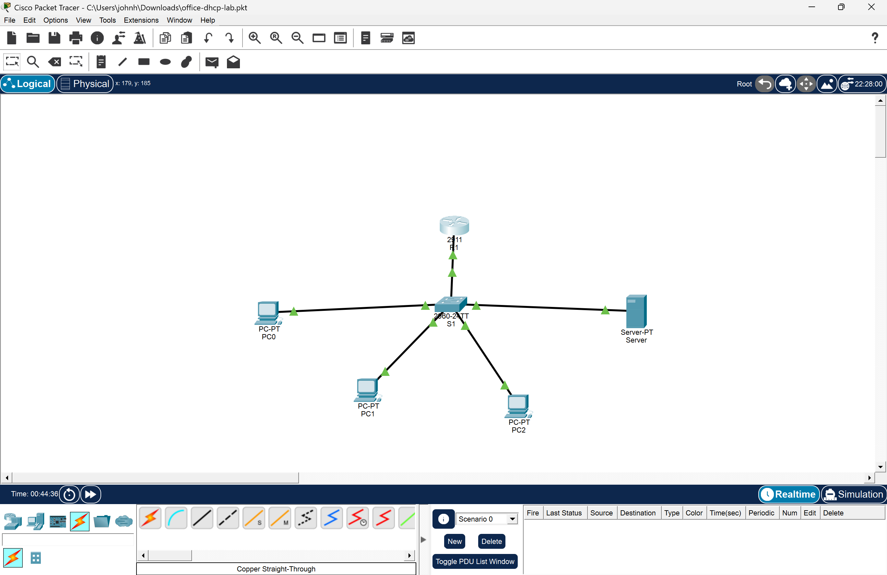
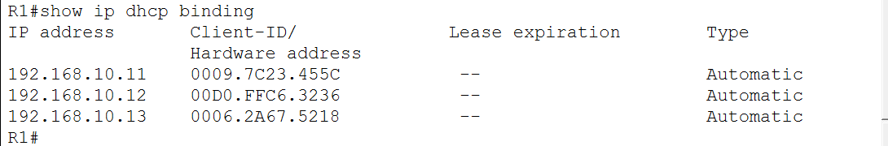

# Small Office Network with DHCP (Cisco Packet Tracer)

A small office network built in Cisco Packet Tracer. A Cisco router hands out IP addresses to PCs automatically using DHCP, and a server provides DNS and a web page that PCs reach by name.



## What This Lab Shows

- Configuring a Cisco router interface from the CLI
- Setting up a DHCP pool with an excluded address range
- Assigning a static IP to a server
- Creating a DNS A record and hosting a web page
- Verifying connectivity with `ping`, `ipconfig`, and `show ip dhcp binding`
- Troubleshooting a misconfigured interface

## Equipment

| Device | Model | Role |
| --- | --- | --- |
| R1 | Cisco 2911 router | Default gateway and DHCP server |
| SW1 | Cisco 2960 switch | Connects all devices |
| PC0, PC1, PC2 | PC-PT | Office workstations (DHCP) |
| Server | Server-PT | DNS and web server (static IP) |

## IP Address Plan

Network: `192.168.10.0/24`

| Device | IP Address | Assignment |
| --- | --- | --- |
| R1 (G0/0) | 192.168.10.1 | Static |
| Server | 192.168.10.5 | Static |
| PC0 to PC2 | 192.168.10.11 and up | DHCP |

Addresses `.1` through `.10` are excluded from DHCP and reserved for network equipment.

## Router Configuration

```
hostname R1
!
interface GigabitEthernet0/0
 ip address 192.168.10.1 255.255.255.0
 no shutdown
!
ip dhcp excluded-address 192.168.10.1 192.168.10.10
!
ip dhcp pool OFFICE
 network 192.168.10.0 255.255.255.0
 default-router 192.168.10.1
 dns-server 192.168.10.5
```

## Server Configuration

- Static IP: `192.168.10.5`, gateway `192.168.10.1`, DNS `192.168.10.5`
- DNS: A record `office.lab` pointing to `192.168.10.5`
- HTTP: enabled

## Verification

All PCs received addresses from the router's DHCP pool:



Tests run from PC0:

| Test | Command | Result |
| --- | --- | --- |
| DHCP address | `ipconfig` | Received 192.168.10.11 |
| Gateway | `ping 192.168.10.1` | Success |
| Server | `ping 192.168.10.5` | Success |
| PC to PC | `ping 192.168.10.12` | Success |
| DNS | `ping office.lab` | Resolved to 192.168.10.5 |
| Web | Browser to `http://office.lab` | Page loaded |

## Troubleshooting

**Problem:** After setup, all three PCs failed to get a DHCP address, even though every link was up.

**Diagnosis:** Since the links were green, I ruled out cabling and checked the router config with `show running-config`. The G0/0 interface was set to `192.196.10.1` instead of `192.168.10.1`. Because the router's interface wasn't on the same network as the DHCP pool (`192.168.10.0/24`), it ignored the PCs' requests.

**Fix:** Re-entered the correct address on G0/0. All three PCs then received addresses on the first retry.

**Takeaway:** Check the physical layer first, then compare the running config line by line against the plan.

## Files

- `office-dhcp-lab.pkt`: the Packet Tracer lab file
- `screenshots/`: topology and verification screenshots
